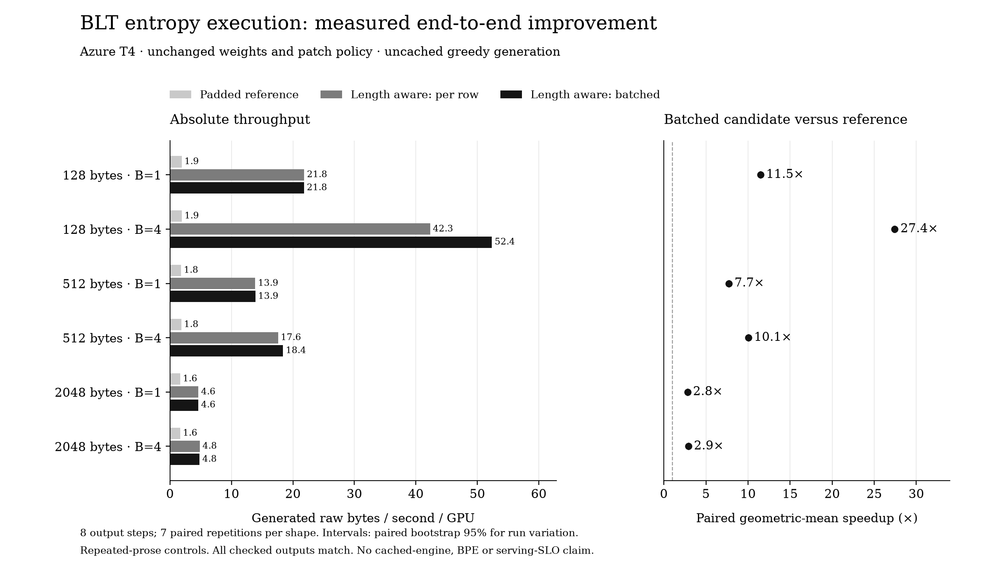

# Native BLT baseline and entropy execution

This package runs pinned Meta BLT checkpoints through the official model code.
It adds correctness gates, byte-level measurement, profiling and a guarded
length-aware entropy path. It is separate from this repository's component
implementation in `../blt/`; it is not a Rust rewrite or a new BLT model.

## Measured results

Historical Azure T4 measurements from 7 and 17 November 2026:

- M0: six padded, request-isolated, uncached controls at 1.70–1.96 raw bytes/s/GPU.
- M1: 2.81–27.41x paired median improvement in the six primary controls;
  about 7.6x in 64-step code/Hindi controls and 12.4x in a mixed four-request batch.
- Direct public `generate_nocache`, same released 1B weights and batch 1:
  10.57x / 7.49x / 2.78x improvements at 128 / 512 / 2048 input bytes.
- 59 harness tests passed locally and on the measured Azure runtime. Independent
  real-weight gates include 36 entropy cases, 27 full-model comparisons and
  108 generated-prefix comparisons. Checked outputs and likelihoods match.



These are improvements over padded **uncached execution** on authored controls.
Matched downstream quality, cached-engine superiority, BPE competitiveness,
serving SLOs and cost per useful output remain unestablished. Timed controls had
zero fallback rows; arbitrary request distributions may trigger extra work.

- [M0 report](reports/M0_BASELINE.md)
- [M1 report](reports/M1_ENTROPY.md)
- [Official code and published-result comparison](reports/PUBLISHED_BASELINES.md)
- [Evidence and publication boundary](reports/README.md)
- [Inference decisions and next state/cache gate](docs/INFERENCE_DESIGN.md)
- [Registered M1 experiment](docs/M1_ENTROPY_EXECUTION_PLAN.md)

## Verify the published observations without a GPU

From this directory, using Python 3.12 or later:

```sh
python scripts/verify_published.py
```

This uses only the standard library. It verifies the exact measured package
source, exported observation hashes, raw byte accounting, stored parity
witnesses and recomputed paired summaries. It does not rerun the GPU experiment.
Original metadata paths and large traces are not part of this public export.

## Test the harness

From the repository root, use the existing CPU-capable Torch test environment:

```sh
.venv/bin/python -m pytest -c blt-baseline/pyproject.toml blt-baseline/tests -q
```

Alternatively, install this package with the `test` extra in your own Torch
runtime. GPU execution dependencies are intentionally not installed implicitly.

## Prepare the pinned upstream source

From the repository root:

```sh
git clone https://github.com/facebookresearch/blt.git vendor/blt
git -C vendor/blt checkout --detach 9774ed4fcc78313f9f218295f3d7e4decdadf2ae
```

`vendor/blt` is ignored. This package never substitutes the repository's partial
`blt/` implementation for the official full model.

Prepare your authorized local Hugging Face snapshots for `facebook/blt-1b`
revision `8134b32f0b1d25d1248c30e8c7bdfd442d3bb380` and `facebook/blt-entropy`
revision `f2aae511e44e2086b1204bc4ddec6ac6c9651332`. The run itself is offline;
missing snapshots fail rather than trigger a download. `scripts/fetch_checkpoints.py`
is an explicit preparation step; read its CLI help before use. Never commit
weights, login tokens, private keys or machine-specific configs.

## Run on the measured T4 configuration

Use an isolated GPU runtime, rather than downgrading the repository's CPU/dev
Torch environment. The admitted pair was **torch 2.10.0+cu128 / xformers 0.0.35**;
see [runtime and hardware notes](docs/AZURE_T4_RUNBOOK.md) and the recorded package
versions in [provenance](reports/evidence/provenance.json). Kernels and full-model
parity must be checked on a new runtime.

From this directory:

```sh
export PYTHONPATH="$PWD/src"
export HF_HUB_OFFLINE=1
export HF_DATASETS_OFFLINE=1
python -m blt_baseline.cli doctor --config configs/t4-padded.example.json --out runs/check-001
python scripts/probe_entropy_execution.py --config configs/t4-padded.example.json --out runs/entropy-gate-001
python scripts/run_entropy_ablation.py --config configs/t4-padded.example.json --entropy-gate runs/entropy-gate-001/result.json --out runs/ablation-001
```

Copy a config to `configs/my-machine.local.json` if snapshot/source locations
need editing. Existing example paths resolve relative to the config file;
`~` paths resolve to your own home. Run directories are immutable attempts: use
a new output path for each retry.

For the normal CLI, select `configs/t4-length-aware.example.json` explicitly.
Older/default configs retain padded execution. Generation remains greedy,
fixed-step and uncached; specials/invalid UTF-8 are reported separately.

## Implementation boundary

`LengthAwarePatcher` removes only trailing entropy padding, retains native
8192-position chunk resets/EOS masks and native boundary selection, and batches
equal-length requests along the batch axis. A 0.002-nat decision-margin guard
re-evaluates ambiguous rows with the original padded path. It is empirical
numerical protection, not a universal floating-point error proof.

Main weights/precision and positional-buffer precision are preserved. Timings
include encoding, transfers, patching, model execution, commit and byte accounting;
loading, warmup and profiling are separate. BPB uses full-vocabulary normalization
and causal prefixes. No hidden context truncation or attention padding as bytes.

Official source and checkpoints retain their respective licenses. See the linked
upstream repository and model cards for those terms.
